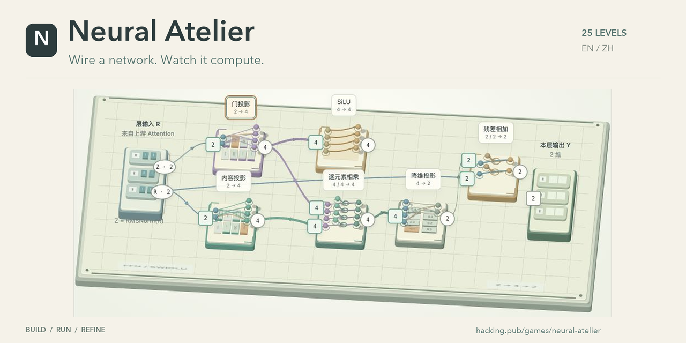
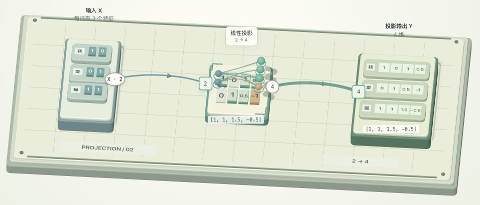

# 神经工坊 · Neural Atelier

[English](README.md) · **简体中文**

[](https://hacking.pub/games/neural-atelier/)

一个在 3D 桌面上搭建神经网络的网页解谜游戏。拖动组件、连接端口，再试跑自己的网络：向量会沿线路移动，经过矩阵映射和其他计算，最后与目标结果比较。

**[在线试玩 →](https://hacking.pub/games/neural-atelier/)** · [本地启动](#本地启动) · [怎么玩](#怎么玩)

目前有 25 个关卡，从连接第一个向量开始，逐步加入矩阵投影、FFN、Q/K/V、RoPE、Attention、自回归，以及 CPU / GPU / ANE 调度、量化、KV 缓存等端侧推理概念。

## 工坊里有什么

从一根线、一块小矩阵开始，逐步组合投影、激活、门控和残差，接出完整的 FFN。双击模块可以打开介绍卡片，转动立体模型，查看它的计算方式。

| 向量经过矩阵映射 | 打开卡片，看看模块内部 |
| --- | --- |
|  |  |

<sub>以上画面与封面取自较早的中文版本实机截图。当前游戏支持中文和英文。</sub>

接线决定真实计算结果。运行时可以观察数据在网络中流动，最后再查看结果是否符合目标，自己琢磨哪里需要调整。

| 阶段 | 搭建与探索的内容 |
| --- | --- |
| **基础 · 6 关** | 传递向量、矩阵投影、激活、门控、残差，最后接出 FFN。 |
| **Transformer · 10 关** | 词嵌入、归一化、Q/K/V、注意力分数、因果掩码、RoPE 与 Attention；再搭完整层、预测词，并把新词送回上下文。 |
| **端侧推理 · 9 关** | CPU / GPU / ANE 分工、张量布局、批处理、KV 缓存、量化、融合、并行执行与前缀复用。 |

## 怎么玩

- 点圆形输出口，再点方形输入口完成接线，也可以拖拽接线。
- 拖动模块调整布局；拖动场景旋转视角，滚轮缩放。
- 双击模块打开介绍卡片，查看作用和计算示例。
- 点击“试跑我的网络”，观察向量的流动与计算，结果会在运行后显示。
- 在“设置”里统一调整速度、语言、背景音乐和音量；通过关卡菜单切换章节。
- 点击左上角的 N / 神经工坊标志，可以回到首页。
- 默认按照浏览器语言偏好选择中文或英文，可以手动覆盖。切换语言保留接线和关卡进度。
- 默认运行速度为 **0.25×**，手动选择的速度会被记住。
- 开场可直接点击“进入工坊”或按 Esc 跳过；音乐在用户操作后开始，切到后台会暂停。

关卡和接线进度保存在当前浏览器的 `localStorage` 中。URL 中的 `#wire`、`#projection` 等只定位关卡，不携带自己的接线或通关记录。

面向桌面浏览器，需要 WebGL 2；目前不支持手机布局。

## 本地启动

需要 Node.js 22 或更高版本。在终端克隆项目并安装开发依赖：

```sh
git clone https://github.com/chainhelen/neural-atelier.git
cd neural-atelier
npm ci
npm run dev
```

如果已经有源码，进入项目目录后执行 `npm ci` 和 `npm run dev` 即可。

打开 <http://127.0.0.1:5173/>。按 `Ctrl+C` 停止服务。依赖安装后，平时启动只需 `npm run dev`；修改代码后刷新浏览器查看效果。

只想试玩，也可以不用 Node.js，在项目目录运行：

```sh
python3 -m http.server 5173 --bind 127.0.0.1
```

请通过 HTTP 打开，直接双击 `index.html` 会受到浏览器对 ES Module 的限制。

## 项目结构

这是无需构建的纯前端项目，使用原生 HTML / CSS / JavaScript 和本地附带的 Three.js r180。运行时没有后端接口、账号服务或数据库；Node.js 只用于开发服务器和测试。

| 文件 | 内容 |
| --- | --- |
| `index.html`、`style.css` | 页面与样式 |
| `game.js` | 交互、场景、连线、运行动画和关卡导航 |
| `model.js` | 基础计算、连线检查和前六关 |
| `campaign.js` | 后续关卡和微型 Transformer 计算 |
| `engine-model.js` | 调度、存储、量化等教学成本模型 |
| `scene-art.js` | 3D 组件与矩阵视觉效果 |
| `module-cards.js` | 模块介绍卡片 |
| `level-progress.js` | 本地进度与接线存档 |
| `i18n.js`、`locales/en.js` | 浏览器语言检测和中英文本 |
| `shell.js` | 开场入口与统一设置 |
| `music.js` | 原创合成背景音乐，无外部音频下载 |
| `vendor/` | Three.js 及其 MIT 许可证 |

## 测试

```sh
npm test
```

测试覆盖关卡解法、数值计算、进度恢复、关卡链接和动画状态。DOM 与场景测试使用 LinkeDOM 和模拟渲染器，视觉效果和鼠标命中仍需要在浏览器里检查。GitHub Actions 会在 push 和 pull request 时运行这些测试。

欢迎提交想法、问题和 PR。反馈游戏问题时，可以附上关卡链接、浏览器、复现步骤和截图；新玩法建议先做一个能试玩的小例子，尽早检验交互方向。

## 部署

可放在 Nginx、GitHub Pages 或其他静态网站托管服务上。网页使用相对资源路径和 hash 关卡导航，支持部署到 `/games/neural-atelier/` 这样的子目录，无需配置应用路由回退。

网站运行需要根目录的 HTML、CSS、JavaScript 文件，以及 `locales/` 和 `vendor/`。不需要上传 `node_modules/`、测试、Git 数据或开发服务器。

公开仓库也可以用 GitHub Pages 免费托管试玩页面：

1. 将源码推送到仓库的 `main` 分支。
2. 打开仓库的 **Settings → Pages**。
3. 在 **Build and deployment** 中选择 **Deploy from a branch**，分支选 `main`，目录选 `/(root)`，保存。
4. 等待部署完成，通过 Pages 显示的网址打开游戏，通常为 `https://chainhelen.github.io/neural-atelier/`。

项目包含 `.nojekyll`，不需要构建命令，也不需要在 GitHub 上运行 `npm run dev`。已有的 GitHub Actions 工作流负责测试；Pages 负责发布静态文件。

## 教学范围

小矩阵的投影、注意力和 FFN 执行真实的算术计算；ANE 调度和性能数字使用简化的教学模型。游戏不加载真实大模型，也不会调用苹果 ANE。设计参考 Kapitsa 的端侧推理思路，参考版本和模型假设见 [ENGINE_NOTES.md](ENGINE_NOTES.md)。

Three.js 的第三方授权保留在 [vendor/LICENSE](vendor/LICENSE)。
